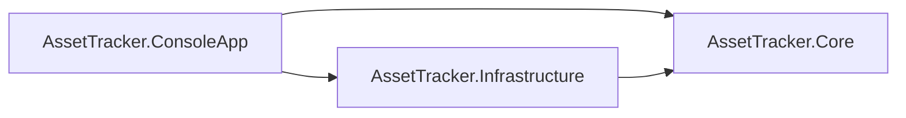
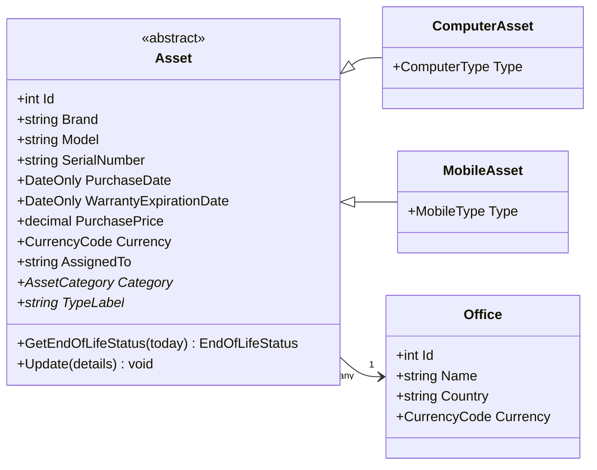
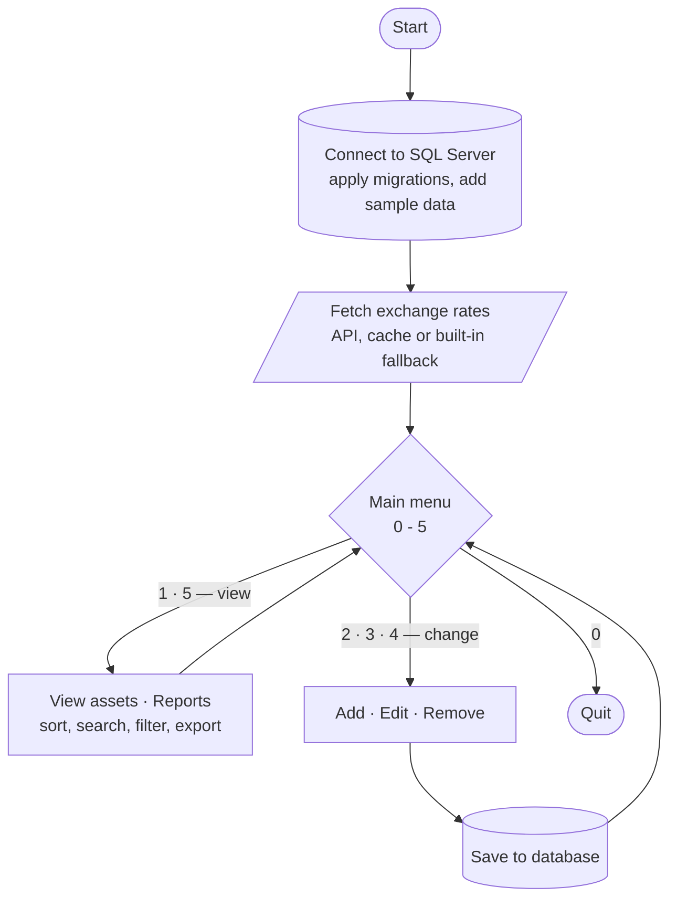

# Dragon's Hoard — Asset Tracking System

A console application for tracking company IT assets across offices and currencies, written in
C# on .NET 10 with Entity Framework Core and SQL Server.

> Weekly mini project, week 46 — Full Stack C# .NET Web Development with AI-powered development
> Author: Niclas Hugdahl

> **Status: in progress.** The design is finished and the application is being built step by
> step from the [build plan](docs/PROJECT_CONTEXT.md#12-build-plan-one-step--one-commit). This
> README describes the finished application; [Progress](#progress) shows what works today.

---

## Table of contents

- [About](#about)
- [Progress](#progress)
- [Features](#features)
- [Getting started](#getting-started)
- [Usage](#usage)
- [Project structure](#project-structure)
- [Architecture](#architecture)
- [Domain model](#domain-model)
- [Application flow](#application-flow)
- [Data storage](#data-storage)
- [Design decisions](#design-decisions)
- [Planning and documentation](#planning-and-documentation)
- [Roadmap](#roadmap)

---

## About

Dragon's Hoard keeps a register of a company's laptops, desktops, phones and tablets. Each asset
belongs to an office, keeps the price that was paid for it in local currency, shows its value in
EUR at today's exchange rate, and is flagged as it approaches the end of its three-year lifetime. Assets can be listed, sorted, searched,
filtered, edited and removed through a text-based menu, summarised in reports, and exported to
file.

It is a rebuild of the [week 38 asset tracker](../Week38/README.md): the JSON file is replaced
by a SQL Server database, the single project is split into domain, persistence and user
interface, and the console output is drawn with Spectre.Console.

---

## Progress

| Level | Scope | Status |
|-------|-------|--------|
| 1 | Register assets, save to database, list them | Not started |
| 2 | Edit, remove, sort, lifetime highlighting | Not started |
| 3 | Offices, currency conversion, reports | Not started |
| 4 | Search, filters, export to TXT / CSV / JSON | Not started |
| 5 | Roles, login, employees, maintenance, dashboard | Only if there is time |

---

## Features

- Register **computers** (laptop, desktop) and **mobile devices** (phone, tablet) with brand,
  model, serial number, purchase date, warranty expiration, price and an optional assigned user
- **Edit** and **remove** assets, with a details view and a confirmation before deleting
- **Lifetime tracking** — every asset lasts three years, and the list highlights the ones
  running out:

  | Remaining lifetime | Status | Colour |
  |--------------------|--------|--------|
  | Less than 6 months | Monitor | Dark yellow |
  | Less than 3 months | Upgrade soon | Red |
  | Already past 3 years | End of life | Dark red |

- **Four offices** — Germany, Sweden, USA and Turkey — each buying in its own currency
- **Prices in local currency** — an asset keeps the price that was paid for it, in the currency
  it was paid in
- **Live conversion to EUR** with the [Frankfurter API](https://frankfurter.dev/), so assets
  can be compared and totalled across offices. Rates are cached once a day, falling back to the
  last cached rates or built-in rates when offline
- **Sort** by category, office or end of life
- **Search** by brand, model, office and purchase year
- **Filter** to expired assets, computers only or mobile devices only
- **Paginated lists**, with sorting, search and filters changeable in place
- **Reports** — total value in EUR and asset count per office, assets close to expiration,
  most expensive assets
- **Export** any list or report to TXT, CSV or JSON
- **Saved immediately** — every add, edit and delete goes straight to the database

---

## Getting started

### Prerequisites

- [.NET 10 SDK](https://dotnet.microsoft.com/download)
- [SQL Server Express](https://www.microsoft.com/sql-server/sql-server-downloads), running as
  the default `SQLEXPRESS` instance on your machine

Check what you have:

```bash
dotnet --version
```

### Build and run

```bash
git clone https://github.com/NiclO1337/weekly-projects-lexicon.git
cd weekly-projects-lexicon/Week46

dotnet build
dotnet run --project src/AssetTracker.ConsoleApp
```

The first run creates the `asset_tracker_ef` database, applies the migrations and adds sample
assets. There is no SQL script to run by hand.

### Using a different SQL Server

By default the application connects to

```
Server=localhost\SQLEXPRESS;Database=asset_tracker_ef;Integrated Security=true;Encrypt=false;
```

To use another server or instance, set `APP_DB_CONNECTION` — either as an environment variable
or as a user secret, so the connection string never ends up in the repository:

```bash
dotnet user-secrets set "APP_DB_CONNECTION" "<your connection string>" --project src/AssetTracker.Infrastructure
```

---

## Usage

The application opens with an intro, connects to the database, fetches exchange rates, and then
shows the main menu. It returns there after every action. `0` always means back, cancel or quit.

```
1. View assets
2. Add asset
3. Edit asset
4. Remove asset
5. Reports
0. Quit
```

The asset list is paginated. Its sorting, search terms and filters can be changed without
leaving the screen, and the current list can be exported from there. Edit and remove use the
same list, so an asset can be searched for before picking its ID.

Dates are entered as `YYYY-MM-DD`, for example `2026-03-17`. Prices are entered in the
office's own currency and accept both `14990,50` and `14990.50`. Type `q` at a text prompt to cancel.

Screenshots are added when the user interface is finished.

---

## Project structure

```
Week46/
├── Week46.slnx                       # solution (.NET 10 XML format)
├── Directory.Build.props             # MSBuild settings shared by every project
├── CLAUDE.md                         # coding rules for AI assistance
├── docs/
│   └── PROJECT_CONTEXT.md            # full design document and build plan
└── src/
    ├── AssetTracker.Core/            # domain models and business logic
    ├── AssetTracker.Infrastructure/  # database, migrations, currency API, file export
    └── AssetTracker.ConsoleApp/      # console UI and composition root
        └── UI/                       # menus, tables, input and colour handling
```

---

## Architecture

Three projects, with dependencies pointing inward toward the domain:



`AssetTracker.Core` references no other project and no NuGet package. It defines the interfaces
it needs — a repository, a currency provider, a report exporter — and
`AssetTracker.Infrastructure` implements them with Entity Framework Core, an HTTP client and
the file system. This is the **dependency inversion principle**: the domain declares what it
needs, and the outer layer supplies it.

The practical benefit: because `Core` has no reference to Entity Framework Core or
Spectre.Console, it is a compile error for a domain class to run a database query or write to
the screen. Moving from the JSON file of week 38 to a database changed the persistence layer,
not the rules about assets.

---

## Domain model

Computers and mobile devices are distinguished by **inheritance**:



`Category` and `TypeLabel` are abstract, so each subclass says what it is. No menu, service or
exporter asks "is this a computer?" — they read the property, and a new kind of asset would
mean a new subclass rather than edits to every screen.

The three-year lifetime rule lives in one class, `AssetLifecycle`. Both the status shown on a
row and the "expired only" database filter are computed from it, so they cannot disagree.

---

## Application flow



Options that only *read* return straight to the menu. Options that *change* data all end in the
same save step, so the database is always current and there is no separate "save" command.

---

## Data storage

Data lives in a SQL Server database called `asset_tracker_ef`, created and updated through
Entity Framework Core migrations.

| Table | Contents |
|-------|----------|
| `Offices` | The four offices with country and currency |
| `Assets` | Every asset, computers and mobile devices together. An `AssetCategory` column tells Entity Framework Core which class to create for each row |

Each asset stores the price that was paid and the currency it was paid in. Its value in EUR is
calculated from the current exchange rate each time it is shown, never stored. Serial numbers
are unique.

Two kinds of file are written next to the source, in
`src/AssetTracker.Infrastructure/Data/`, and neither is committed: the daily exchange-rate
cache and anything exported from the application (`exports/`).

---

## Design decisions

| Decision | Reasoning |
|----------|-----------|
| Inheritance for computer / mobile assets | Each type carries its own label and category; nothing switches on type |
| Repository behind an interface | The domain does not know it is talking to SQL Server, and Entity Framework Core stays in one project |
| Queries run in the database | Sorting, searching, filtering and paging are LINQ translated to SQL, not lists filtered in memory |
| Prices stored in local currency, EUR value calculated | The price paid is a fact and must not move with the exchange rate — see below |
| Currency belongs to the asset, not the office | An asset moved to another office keeps the price and currency it was bought in |
| Prices never compared across currencies | Rankings and totals convert to EUR first; 40 000 TRY is less than 1 500 EUR |
| `decimal`, never `double` | Binary floating point cannot represent `0.1` exactly, and money arithmetic must be exact |
| Lifetime rule in one class | The coloured status and the "expired" filter come from the same three dates |
| Currency provider never fails | No network means a warning and older rates, not a crash |
| Spectre.Console draws, numbered menus ask | Tables and colour from the library; the same `0` = back menu on every screen |
| Connection string from user secrets or environment | No machine-specific setting or secret in the repository |

### Why prices are stored in local currency

The assignment describes prices entered in one currency and converted to each office's local
currency for display. This project does it the other way round, on purpose.

An office buys its equipment locally — shipping a phone from Germany to Turkey or the USA would
cost more than buying it there. So the Swedish office pays 14 990 kr for a laptop, and 14 990 kr
is the value in its bookkeeping. If the application stored a price in EUR and converted it to
SEK for display, that same laptop could be listed at 15 437 kr once the exchange rate had moved:
a price nobody ever paid.

So the stored value is the fact — what was paid, in the currency it was paid in — and the
converted value is the one that is allowed to move: each asset's value in EUR, used to compare
assets and to total them across offices. The exchange-rate API, the caching and fallback, and
the conversion logic are all still there. Only the direction changed.

📄 **[Full design document →](docs/PROJECT_CONTEXT.md)**

---

## Planning and documentation

| Document | Contents |
|----------|----------|
| [`docs/PROJECT_CONTEXT.md`](docs/PROJECT_CONTEXT.md) | Complete design: requirements from the brief, agreed decisions, solution layout, domain model, services, persistence, user interface, validation rules, what is reused from earlier projects, build plan and definition of done |
| [`CLAUDE.md`](CLAUDE.md) | Condensed coding rules — architecture boundaries, naming, what is out of scope |

The design was settled before any code was written. The build plan in `PROJECT_CONTEXT.md` §12
breaks the work into small steps, one commit each, grouped by the levels of the assignment.

Much of the code is carried over from two earlier projects: the asset rules and currency
conversion from the [week 38 asset tracker](../Week38/README.md), and the menu system, input
handling and three-project structure from my course milestone project.

---

## Roadmap

Not part of this hand-in, but the design leaves room for them:

- [ ] **Employees** — assign assets to an employee record instead of a free-text user name
- [ ] **Roles and login** — admin, manager and employee, with menu options depending on the role
- [ ] **Maintenance tracking** — last and next maintenance date, with notes
- [ ] **Dashboard** — totals, expiring assets, assets per employee, most used asset type
- [ ] **Unit tests** — the services depend only on interfaces, so they can be tested with
      in-memory fakes and no database
